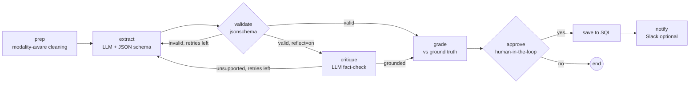

# AI Meeting Notes & Action Items Agent

A LangGraph agent that turns meeting transcripts (and other documents) into **schema-constrained structured JSON**:
summaries, decisions, and action items with owners and deadlines. Results are validated, optionally fact-checked,
scored against ground truth, and stored in SQL for analytics.

Built with **LangGraph · Groq (openai/gpt-oss-120b) · SQLite · jsonschema · pandas**.

## Architecture



## Features

- **Dynamic schemas:** every record brings its own JSON schema; the agent fills it directly (no hard-coded Pydantic models).
- **Modality-aware preprocessing:** ASR meeting transcripts (drop backchannel like "MM", merge same-speaker turns, speaker talk-time stats), OCR text (re-join hyphenated words), plain text.
- **Validate-and-retry loop:** schema errors are sent back to the model as feedback (max 3 attempts).
- **Optional reflection loop:** a second LLM call fact-checks the answer against the transcript.
- **Long-transcript handling:** schema-aware map-reduce (chunk notes → final JSON) plus a token-per-minute rate limiter for free-tier APIs.
- **Human-in-the-loop:** LangGraph `interrupt()` pauses before saving; approve or reject.
- **SQL persistence and analytics:** runs, action items (auto-detected across many key names), speaker stats, experiments.
- **Evaluation harness:** token-F1 scoring with optimal list matching, per-field scores, experiment comparison.

## Data

Three JSONL files, each record = `context + question + json_schema + ground_truth`:

| File | Records | Content |
|---|---|---|
| audio.jsonl | 115 | ASR meeting transcripts with speaker IDs and timestamps |
| text.jsonl | 5000 | Wikipedia-style multi-passage text |
| image.jsonl | 209 | OCR text from scanned documents |

Place them in `data/` (not included in this repo).

## Results

Metric: mean token-F1 against ground truth (free-text values partial credit, numbers exact).
Small samples (n shown), so treat as preliminary.

| Experiment | Data | n | Avg score | Avg input tokens |
|---|---|---|---|---|
| text_baseline | text | 10 | 0.947 | 1640 |
| text_no_preprocess | text | 10 | 0.947 | 1640 |
| text_reflection | text | 10 | 0.948 | 3150 |
| audio_direct (v1 prompt) | meetings that fit one request | 3 | 0.656 | 5190 |
| audio_direct_v2 (concise + schema-aware prompt) | same 3 meetings | 3 | 0.691 | 3514 |
| audio_chunked_forced | 1 of those meetings, chunking forced | 1 | 0.269 | 8202 |
| groq_audio (long meetings, chunked) | 2 long meetings | 2 | 0.263 | 29003 |

### Findings

1. **Reflection did not help on text:** +0.001 score for ~1.9x input tokens, so it is off by default.
2. **Preprocessing had no effect on text** (expected: it mostly normalizes whitespace). Its effect on audio is not yet isolated.
3. **Chunking hurts accuracy:** forcing chunked notes on a meeting that fits in one request dropped its score from above 0.61 to 0.269 while using about 2x the tokens. Long meetings (about 60% of the audio set) are the main weakness under the free-tier token-per-minute limit.
4. **Prompt changes gave a small gain** (0.656 to 0.691, same 3 meetings, fewer retries); within noise at this sample size.
5. **Two evaluation-metric bugs were found and fixed:**
   - Unicode non-breaking hyphens/spaces in model output broke word matching.
   - Greedy list matching was order-dependent and could steal a correct match (one real case: 0.054 became 0.391 with optimal assignment via the Hungarian algorithm).
6. **Action-item detection** was generalized: from 13/115 to 25/115 meetings detected in ground truth (26 contain assignee-like keys).

## Limitations

- Small evaluation samples; free-tier daily token cap (200k) limited experiments.
- Token-F1 rewards word overlap, not meaning; paraphrased correct answers score below 1.0. An LLM-judge metric would be better.
- Chunk notes are lossy; a paid tier with higher tokens-per-minute (or a long-context model) would remove chunking for most meetings.
- Speaker IDs (e.g. MEO069) are used as assignees; real names are not in the data.

## Run it

```bash
pip install -r requirements.txt
cp .env.example .env        # add GROQ_API_KEY
```

```python
import batch
batch.run_batch("text", n=5, workers=1, experiment="text_baseline")           # workers=1 on free tier
batch.run_batch("audio", n=3, workers=1, experiment="audio_v1", reflect=False)
batch.compare()                                                              # experiment table
batch.weak_fields("audio_v1", "audio", min_count=1)                          # weakest fields
```

Human-in-the-loop:

```python
from langgraph.checkpoint.memory import MemorySaver
from langgraph.types import Command
import agent
g = agent.build(checkpointer=MemorySaver())
out = agent.run_record(g, record, {"approve": True}, thread_id="demo")   # pauses before saving
g.invoke(Command(resume="yes"), {"configurable": {"thread_id": "demo"}})
```

## Project structure

| File | Purpose |
|---|---|
| `agent.py` | LangGraph state, nodes, routing |
| `llm.py` | Groq calls, JSON-schema mode, chunk notes, rate limiter |
| `preprocess.py` | ASR / OCR / text cleaning, speaker stats |
| `evaluate.py` | Token-F1 scoring, optimal list matching, per-field scores |
| `db.py` | SQLite schema, action-item detection, persistence |
| `batch.py` | Threaded batch runs, experiment comparison, weak-field analysis |
| `loader.py` | JSONL loader |

## Next steps

- LLM-judge scoring; larger samples with a paid tier; Whisper for raw audio input; Slack/Calendar integrations; Streamlit dashboard.
